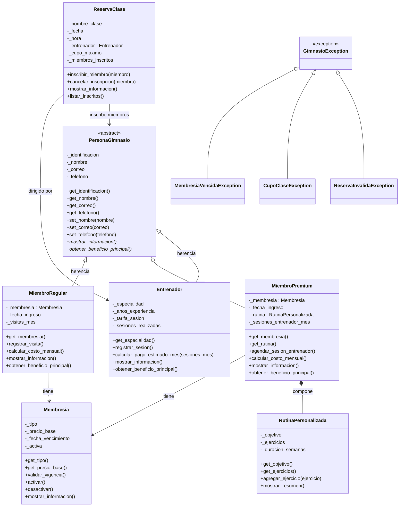

# Diagrama UML de Clases - Sistema de Gestión de Gimnasio

## Notas

- **Herencia (es un):** `MiembroRegular`, `MiembroPremium` y `Entrenador` son tipos especializados de `PersonaGimnasio`.
- **Composición:** `MiembroPremium` crea y contiene una `RutinaPersonalizada`; la rutina forma parte esencial del plan premium.
- **Relaciones:** los miembros tienen una `Membresia`; `ReservaClase` se relaciona con un `Entrenador` y con los miembros inscritos.
- **Excepciones:** jerarquía con clase base `GimnasioException`.
